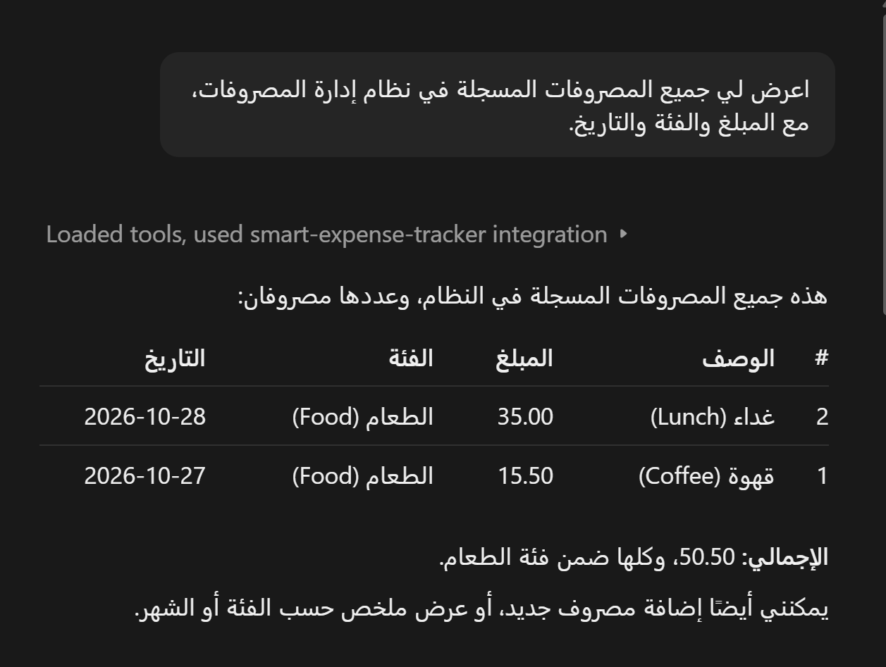
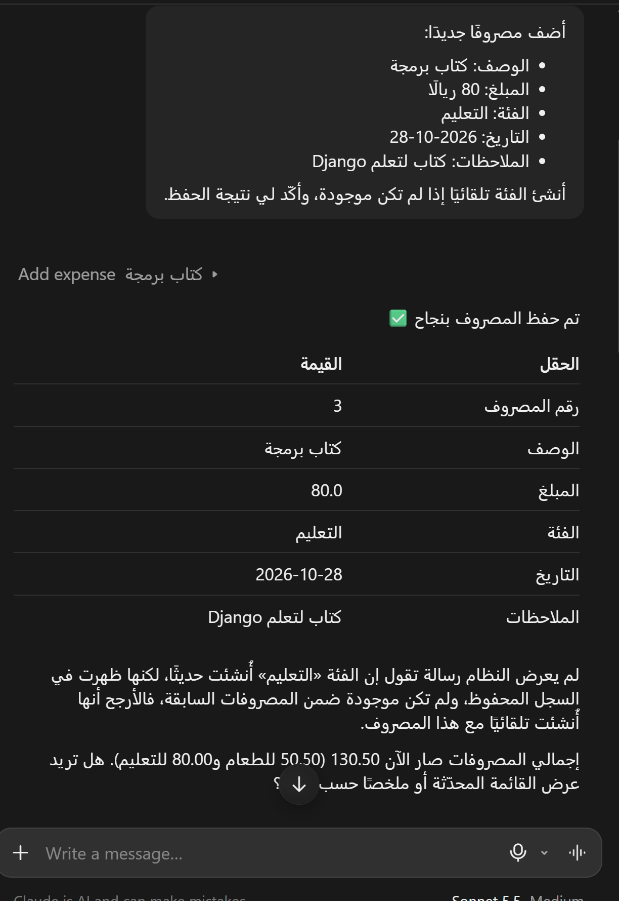
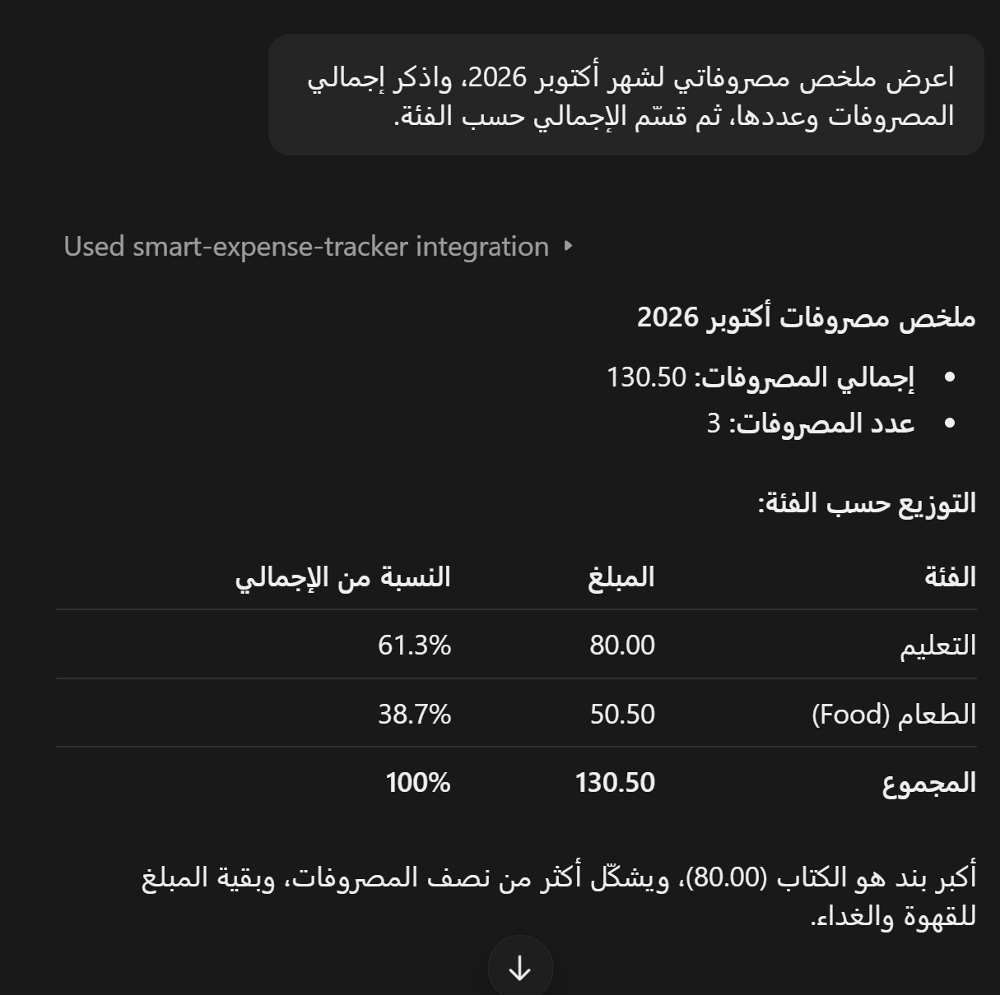
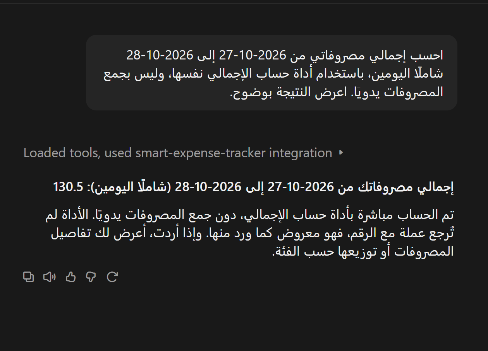

# Smart Expense Tracker

## Overview

Smart Expense Tracker is a personal expense management application built with Django, Django REST Framework, and the Model Context Protocol (MCP). It allows users to manage expenses through a REST API and interact with expense data using AI assistants such as Claude Desktop.

## Technologies Used

- **Python** — Programming language.
- **Django** — Web framework.
- **Django REST Framework** — REST API development.
- **SQLite** — Database.
- **Model Context Protocol (MCP)** — AI assistant integration.
- **Claude Desktop** — MCP client for interacting with the application.

## Screenshots

### View Expenses

### Add Expense

### Monthly Summary

### Total Expenses by Date

### Highest Expense

